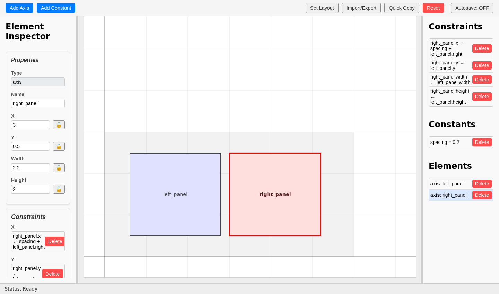
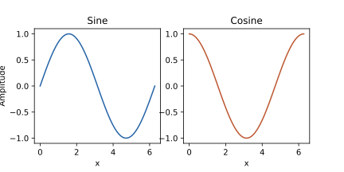

Worked example: two panels with adjustable spacing
==================================================

This example uses two equal-sized axes in a 6-by-3-inch figure. The second axis follows the first axis's size and bottom edge. A constant named ``spacing`` controls the horizontal gap, initially 0.2 inches.

Inspect it in the GUI
---------------------

Copy the complete layout string below. Open **Import/Export**, replace the text in the dialog with this string, and click **Import**:

.. literalinclude:: examples/two_panels.layout.txt
   :language: text

Select ``right_panel`` to see its relationships:

.. code-block:: text

   right_panel.x = left_panel.right + spacing
   right_panel.y = left_panel.y
   right_panel.width = left_panel.width
   right_panel.height = left_panel.height

   The imported layout with right_panel selected and spacing set to 0.2 inches.

You can build the same layout yourself using **Add Axis**, **Add Constant**, the match and alignment presets, and the custom X constraint described in :doc:`designing-layouts`.

Adjust it in Python
-------------------

Click **Quick Copy**. Insert the following line before the final rendering call:

.. code-block:: python

   design.get_constant('spacing').value.set(0.4)

The right panel moves 0.2 inches farther to the right, but its size and vertical alignment remain controlled by the original constraints.

For a complete example, copy the code below into ``two_panels.py``. The layout string is included, so you can run it directly:

.. code-block:: bash

   python two_panels.py

The script writes ``two_panels.svg`` in the current directory:

.. literalinclude:: examples/two_panels.py
   :language: python

   The rendered figure after changing spacing to 0.4 inches.

Verify the relationship
-----------------------

The axes positions returned by Matplotlib are fractions of the figure width. Multiplying the gap by the six-inch figure width recovers its physical size:

.. testsetup::

   import runpy
   make_example = runpy.run_path(str(example_dir / 'two_panels.py'))['make_example']

.. doctest::

   >>> fig, axes = make_example(spacing=0.4)
   >>> left = axes['left_panel'].get_position()
   >>> right = axes['right_panel'].get_position()
   >>> round(float((right.x0 - left.x1) * fig.get_figwidth()), 6)
   0.4
   >>> round(float(left.width - right.width), 6)
   0.0
   >>> round(float(left.y0 - right.y0), 6)
   0.0

You can also recreate the layout programmatically. Copy this code into Python and call ``create_layout()`` to get the same design:

.. literalinclude:: examples/create_layout.py
   :language: python
   :start-at: from pyplotdesigner.core.design import Design
   :end-at:     return design

.. testcode::
   :hide:

   create_layout = runpy.run_path(str(example_dir / 'create_layout.py'))['create_layout']
   from pyplotdesigner.core.design_loader import load_design
   design = load_design((example_dir / 'two_panels.layout.txt').read_text())
   assert design.is_equivalent_to(create_layout())
   baseline_fig, baseline_axes = make_example(spacing=0.2)
   baseline_right = baseline_axes['right_panel'].get_position()
   assert abs((right.x0 - baseline_right.x0) * fig.get_figwidth() - 0.2) < 1e-10
